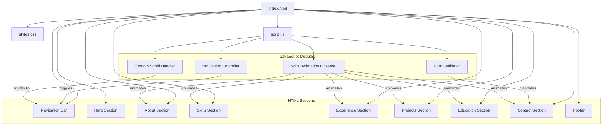

# Design Document: Portfolio Website

## Overview

A single-page responsive portfolio website for Kalyana Tirupathi Rao, a Data Engineer. The site is built with plain HTML, CSS, and vanilla JavaScript — no frameworks or build tools required. It presents professional information across multiple sections (Hero, About, Skills, Experience, Projects, Education, Contact, Footer) with smooth scrolling navigation, responsive layouts, scroll-triggered animations, and a client-side validated contact form.

### Key Design Decisions

- **No framework**: A static portfolio site doesn't need React/Vue/Angular. Plain HTML/CSS/JS keeps it simple, fast, and dependency-free.
- **Single HTML file + separate CSS/JS**: One `index.html` with linked `styles.css` and `script.js` files for clean separation of concerns.
- **CSS custom properties for theming**: A consistent color scheme managed via CSS variables makes future theme changes trivial.
- **Mobile-first responsive approach**: CSS written for mobile first, then enhanced with media queries for tablet (768px) and desktop (1024px).
- **Intersection Observer for animations**: Native browser API for scroll-triggered animations — no library needed.
- **Client-side form validation**: Vanilla JS validation for the contact form since there's no backend.

## Architecture

The website follows a simple static site architecture with three files:

```
portfolio-website/
├── index.html      # Semantic HTML structure with all sections
├── styles.css      # All styling, responsive breakpoints, animations
└── script.js       # Navigation toggle, smooth scroll, form validation, scroll animations
```

### Architecture Diagram



## Components and Interfaces

### 1. Navigation Bar (`<nav>`)

- Fixed position at viewport top (`position: fixed`)
- Contains logo/name and navigation links to each section
- Hamburger menu button visible below 768px, hidden on desktop
- Links: About, Skills, Experience, Projects, Education, Contact

**JavaScript Interface:**
```js
// Toggle mobile menu open/close
function toggleMobileMenu() → void

// Close mobile menu when a link is clicked
function closeMobileMenu() → void
```

### 2. Hero Section (`<section id="hero">`)

- Full-viewport-height introductory banner
- Displays: full name, professional title, tagline, CTA button
- CTA button triggers smooth scroll to Contact section

### 3. About Section (`<section id="about">`)

- Professional summary paragraph
- Experience duration: "0 years 11 months"
- Location: "Kakinada, India"
- Hobbies list
- Language proficiencies: English, Telugu, Hindi

### 4. Skills Section (`<section id="skills">`)

- Skills grouped into categories:
  - **Programming**: Python, Data Structures, HTML, CSS
  - **Data Engineering**: PySpark, Databricks, ETL Pipelines, Azure Data Factory
  - **Data Science & AI**: Artificial Intelligence, Machine Learning, Data Science, Data Science Analyst
  - **Tools & Other**: Excel, PowerPoint, Problem Solving
- Each skill rendered as a tag/card element

### 5. Experience Section (`<section id="experience">`)

- Two sub-sections: "Professional Experience" and "Internships"
- Entries in reverse chronological order
- Each entry: role title, company, date range, description with technologies

**Entries:**
| Type | Role | Company | Duration |
|------|------|---------|----------|
| Full-time | Data Engineer | Cliff IT Solutions | Apr 2025 - Present |
| Internship | Data Science & ML Virtual Internship | Edureka | 6 months |
| Internship | ML using Python – Summer Internship | IIIT Hyderabad | 3 months |

### 6. Projects Section (`<section id="projects">`)

- Card-based layout for each project
- Each card: project name, duration, description, technologies, quantifiable achievements

**Projects:**
1. APAC Data Pipeline Migration
2. End-to-End ETL Pipeline using Azure Data Factory and Databricks
3. Sales Data Analytics Dashboard

### 7. Education Section (`<section id="education">`)

- Entries in reverse chronological order
- Each entry: degree/qualification, institution, year, grade/marks

### 8. Contact Section (`<section id="contact">`)

- Contact info: email (mailto link), phone, LinkedIn link
- Contact form with fields: name, email, subject, message
- Client-side validation on submit

**JavaScript Interface:**
```js
// Validate all form fields, return { valid: boolean, errors: string[] }
function validateContactForm(formData: { name, email, subject, message }) → { valid: boolean, errors: string[] }

// Handle form submission event
function handleFormSubmit(event: Event) → void
```

### 9. Footer (`<footer>`)

- Social links: LinkedIn, email
- Copyright notice: "© {currentYear} Kalyana Tirupathi Rao"

### 10. Scroll Animation Observer

**JavaScript Interface:**
```js
// Initialize IntersectionObserver for all animatable sections
function initScrollAnimations() → void
```

### 11. Smooth Scroll Handler

**JavaScript Interface:**
```js
// Scroll to target section with smooth behavior
function scrollToSection(sectionId: string) → void
```

## Data Models

This is a static website with no database or API. All data is hardcoded in the HTML. The only runtime data structure is the contact form validation:

### Contact Form Data

```js
// Form field values collected on submit
{
  name: string,      // Required, non-empty
  email: string,     // Required, must match email pattern
  subject: string,   // Required, non-empty
  message: string    // Required, non-empty
}
```

### Validation Result

```js
// Returned by validateContactForm()
{
  valid: boolean,       // true if all fields pass validation
  errors: string[]      // List of human-readable error messages for invalid fields
}
```


## Correctness Properties

*A property is a characteristic or behavior that should hold true across all valid executions of a system — essentially, a formal statement about what the system should do. Properties serve as the bridge between human-readable specifications and machine-verifiable correctness guarantees.*

Most of this portfolio website consists of static HTML content and CSS styling, which are best validated with smoke tests and example-based tests. However, the contact form validation function (`validateContactForm`) is a pure function with meaningful input variation — different combinations of empty/filled fields and valid/invalid email formats produce different validation results. This makes it a good candidate for property-based testing.

### Property 1: Empty required fields produce corresponding errors

*For any* form data object where one or more required fields (name, email, subject, message) are empty strings or whitespace-only, `validateContactForm` SHALL return `valid: false` and the `errors` array SHALL contain exactly one error message for each empty/whitespace field, and no errors for fields that have non-empty, valid content.

**Validates: Requirements 8.5**

### Property 2: Email format validation

*For any* form data object where the email field contains a string that does not match a valid email pattern (e.g., missing `@`, missing domain, consecutive dots), `validateContactForm` SHALL return `valid: false` with an error message indicating the email is invalid, even if all other fields are non-empty.

**Validates: Requirements 8.5**

### Property 3: Fully valid form data passes validation

*For any* form data object where all required fields are non-empty, non-whitespace strings and the email field matches a valid email pattern, `validateContactForm` SHALL return `valid: true` and an empty `errors` array.

**Validates: Requirements 8.5**

## Error Handling

### Contact Form Validation Errors

| Error Condition | Behavior |
|----------------|----------|
| Empty name field | Display "Name is required" below the name input |
| Empty email field | Display "Email is required" below the email input |
| Invalid email format | Display "Please enter a valid email address" below the email input |
| Empty subject field | Display "Subject is required" below the subject input |
| Empty message field | Display "Message is required" below the message input |
| Multiple empty fields | Display all applicable error messages simultaneously |
| Successful validation | Display a success message (e.g., "Thank you for your message!") and reset the form |

- Error messages are displayed inline below each invalid field using a `.error-message` CSS class.
- Error messages are cleared when the user starts typing in the corresponding field.
- Since there is no backend, the form submission shows a client-side success message only. No data is actually sent.

### Navigation Errors

| Error Condition | Behavior |
|----------------|----------|
| Target section not found | `scrollToSection()` fails silently — no scroll occurs |
| JavaScript disabled | Navigation links use `href="#sectionId"` as fallback for native anchor behavior |

### Scroll Animation Errors

| Error Condition | Behavior |
|----------------|----------|
| IntersectionObserver not supported | Sections render in their final visible state (no animation, no breakage) |
| No animatable elements found | Observer initialization completes without error |

### Accessibility Fallbacks

- All interactive elements have visible focus indicators via CSS `:focus-visible`.
- The hamburger menu button has `aria-expanded` and `aria-label` attributes updated by JavaScript.
- If CSS animations are disabled via `prefers-reduced-motion: reduce`, animations are skipped.

## Testing Strategy

### Testing Approach

This project uses a dual testing approach:

1. **Example-based unit tests** — Verify specific content, structure, and behavior using concrete examples
2. **Property-based tests** — Verify universal properties of the `validateContactForm` function across many generated inputs

### Test Framework

- **Test runner**: Any lightweight JS test runner (e.g., Vitest or Jest)
- **Property-based testing library**: [fast-check](https://github.com/dubzzz/fast-check) for JavaScript property-based testing
- **DOM testing**: jsdom environment for testing HTML structure and form validation without a browser

### Unit Tests (Example-Based)

These tests verify specific, concrete behaviors:

| Test Area | What to Verify |
|-----------|---------------|
| HTML Structure | Semantic elements present (header, nav, main, section, footer) — Req 12.4 |
| Hero Section | Name, title, tagline, CTA button present — Req 1.1–1.4 |
| Navigation | All 6 section links present with correct hrefs — Req 2.1 |
| About Section | Professional summary, experience duration, location, hobbies, languages — Req 3.1–3.3, 13.1–13.2 |
| Skills Section | All 15 skills present, grouped into categories — Req 4.1–4.3 |
| Experience Section | All entries present, internships separate, reverse chronological order — Req 5.1–5.6 |
| Projects Section | All 3 projects with name, duration, description, technologies, achievements — Req 6.1–6.4 |
| Education Section | All 3 entries in reverse chronological order — Req 7.1–7.4 |
| Contact Section | Email mailto link, phone, LinkedIn link, form with 4 fields — Req 8.1–8.4 |
| Footer | LinkedIn link, email link, copyright with current year — Req 9.1–9.3 |
| Accessibility | All images have alt text, minimum font size 16px — Req 11.2, 12.2 |

### Property-Based Tests

Property-based tests use fast-check to generate random inputs and verify universal properties of the `validateContactForm` function. Each test runs a minimum of 100 iterations.

| Property | Test Description | Tag |
|----------|-----------------|-----|
| Property 1 | Generate form data with random combinations of empty/non-empty fields. Verify errors match exactly the empty fields. | Feature: portfolio-website, Property 1: Empty required fields produce corresponding errors |
| Property 2 | Generate form data with all fields non-empty but email set to random invalid strings. Verify validation rejects with email error. | Feature: portfolio-website, Property 2: Email format validation |
| Property 3 | Generate form data with all fields as valid non-empty strings and email matching a valid pattern. Verify validation passes with no errors. | Feature: portfolio-website, Property 3: Fully valid form data passes validation |

### Integration / Manual Tests

These require a browser environment and are best run manually or with browser automation:

| Test Area | What to Verify |
|-----------|---------------|
| Smooth Scrolling | Clicking nav links scrolls to correct section — Req 2.2 |
| Fixed Navigation | Nav stays at top during scroll — Req 2.3 |
| Hamburger Menu | Menu appears at <768px, toggles on click — Req 2.4–2.5 |
| Responsive Layouts | Desktop (≥1024px), tablet (768–1023px), mobile (<768px) layouts — Req 10.1–10.3 |
| No Horizontal Scroll | No overflow at any breakpoint — Req 10.4 |
| Scroll Animations | Sections animate on viewport entry — Req 11.3 |
| Keyboard Navigation | All interactive elements reachable via Tab — Req 12.3 |
| Page Load Performance | Initial content loads within 3 seconds — Req 12.1 |
| Color Contrast | Text/background contrast ratio ≥ 4.5:1 — Req 11.4 |
